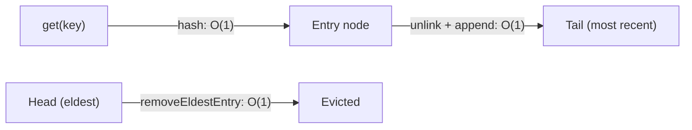
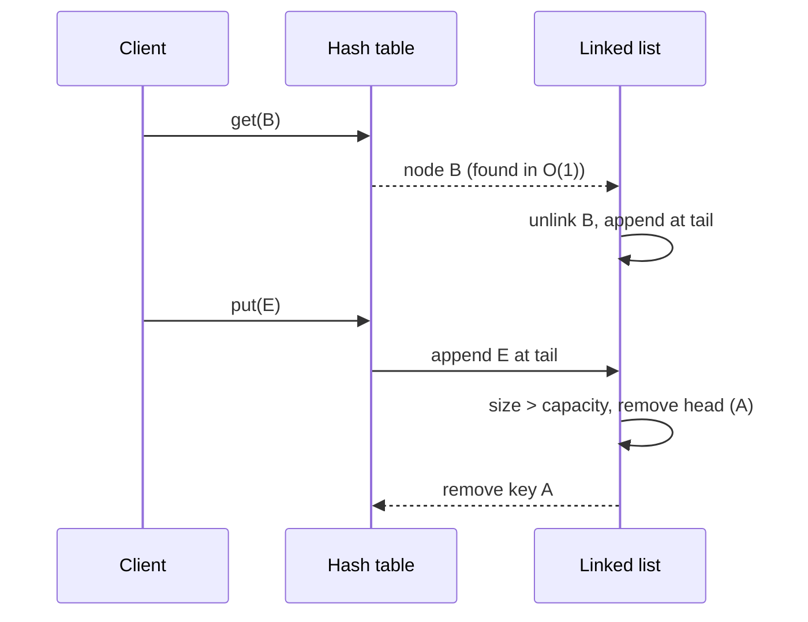

# LRU cache and LinkedHashMap: why they fit together

> **One-line summary:** A HashMap knows **where** each entry is but not **when** it was used. A linked list knows **when** but not **where**. LRU needs both, and `LinkedHashMap` is both in a single structure, so every LRU operation is O(1).

---

## Contents

1. [What an LRU cache has to do](#1-what-an-lru-cache-has-to-do)
2. [Building block 1: the HashMap (fast "where")](#2-building-block-1-the-hashmap-fast-where)
3. [Building block 2: the linked list (cheap "when")](#3-building-block-2-the-linked-list-cheap-when)
4. [Why neither works alone](#4-why-neither-works-alone)
5. [LinkedHashMap = both in one](#5-linkedhashmap--both-in-one)
6. [Why the list must be doubly linked](#6-why-the-list-must-be-doubly-linked)
7. [Walkthrough: get and put](#7-walkthrough-get-and-put)
8. [Java implementation](#8-java-implementation)
9. [Why LinkedHashMap was the right choice](#9-why-linkedhashmap-was-the-right-choice)
10. [Caveats](#10-caveats)
11. [Quick revision](#quick-revision)

---

## 1. What an LRU cache has to do

An LRU (least recently used) cache has a fixed capacity. When it is full and a new entry arrives, it evicts the entry that has gone unused for the longest time.

It needs three operations, and all of them should be **O(1)**:

| # | Operation | Meaning | Question it answers |
|---|---|---|---|
| 1 | **Find by key** | `get(key)` returns the value fast | *Where* is key X? |
| 2 | **Mark as recently used** | Every read or write makes the key "newest" | Move X to the newest end (tail) of the queue |
| 3 | **Evict the oldest** | When full, remove the least recently used entry | *Who* has waited longest? |

---

## 2. Building block 1: the HashMap (fast "where")

### How it finds a key in O(1)

A `HashMap` stores entries in an **array** of buckets. To find a key, it does not search. It *calculates* where the key must be:

```
   key "C"
      |
      v
  hash("C") = 0x5A3F...           <- one calculation
      |
      v
  index = hash & (table.length - 1) = 2     (table.length = 8, so the mask is 0b111)
      |
      v
   table[2]                         <- one array access (random access)

   index:   0       1       2       3       4       5       6       7
         +-------+-------+-------+-------+-------+-------+-------+-------+
 table:  |  -    |  A    |  C    |  -    |  B    |  D    |  -    |  -    |
         +-------+-------+-------+-------+-------+-------+-------+-------+
                           ^
                           +-- jumped straight here, nothing else checked
```

> `HashMap` always keeps `table.length` a power of two, so `hash & (length - 1)` is a cheap way to compute `hash % length`.

**Why the jump is possible:** array slots sit **side by side in memory**, so `table[i]` is just
`base address + i x slot size`. One multiplication, one memory read.

> (Collisions are handled by small chains or trees inside a bucket. With a good hash they stay tiny, so average lookup is still O(1).)

### What it *can't* do: track order

Bucket positions come from **hash values**, not time. Look at the table above: A is in slot 1, C in slot 2, B in slot 4. That has nothing to do with the order they were inserted or used.

```
   Inserted in order:  A, B, C, D
   HashMap iterates:   A, C, B, D     <- bucket order, effectively random
```

So a `HashMap` alone **cannot tell you which entry is oldest**. The only workaround is storing a timestamp in each value and scanning all entries for the minimum, which is **O(n)**, and that O(n) comes from your own bookkeeping, not from the map.

---

## 3. Building block 2: the linked list (cheap "when")

### What it's good at: order

A list naturally keeps a sequence. Put the oldest entry at the head and the newest at the tail, and "who is oldest?" is answered in O(1): it's whatever `head` points to.

```
  HEAD                                  TAIL
   |                                     |
   v                                     v
 +---+      +---+      +---+      +---+
 | A | ---> | B | ---> | C | ---> | D | ---> null
 +---+      +---+      +---+      +---+
 oldest                           newest
```

### Why finding a key is O(n)

A linked list has **no index and no shortcut**. Nodes are scattered around memory and connected only by pointers:

```
  Memory (heap):

   0x1000           0x7F40           0x2A10           0x9C08
  +--------+       +--------+       +--------+       +--------+
  | A      |       | B      |       | C      |       | D      |
  | next ------+   | next -------+  | next -------+  | next: null
  +--------+   |   +--------+    |  +--------+    |  +--------+
               |      ^          |     ^          |     ^
               +------+          +-----+          +-----+

  No formula like "base + i x size" can tell you where C lives.
  The only way to learn C's address is to read B's `next` field,
  and the only way to reach B is through A's `next`.
```

So searching for key C means walking pointer by pointer from the head:

```
 step 1:  [A] -> B -> C -> D      is A == C?  no  -> follow next
           ^
 step 2:   A -> [B] -> C -> D     is B == C?  no  -> follow next
                 ^
 step 3:   A -> B -> [C] -> D    is C == C?  YES -> found
                       ^
```

- **Best case:** key is at the head, 1 step.
- **Worst case:** key is last or missing, **n steps**.
- Each step checks one node, and nothing tells you where the target is ahead of time, so the search is **O(n)**.

### The important distinction

| Action on a linked list | Cost | Why |
|---|---|---|
| **Find** a node by key | **O(n)** | Must walk from the head |
| **Remove / move** a node you already hold a reference to | **O(1)** | Just rewire a few pointers |
| Read the head or tail | **O(1)** | Kept as direct references |

The list is cheap at **rearranging** but slow at **locating**.

---

## 4. Why neither works alone

| Structure | Find by key | Move to "newest" | Find the oldest |
|---|---|---|---|
| `HashMap` | O(1) | Not possible, it keeps no order | Not possible. With a timestamp you store yourself in each value: O(n) scan |
| Linked list alone | O(n), walk from head | O(1) once you have the node | O(1), it's the head |
| **HashMap + doubly linked list** | **O(1)** | **O(1)** | **O(1)** |

Each structure is strong exactly where the other is weak:

```
                 Find by key      Track order
                 (where?)         (when?)
               +--------------+--------------+
   HashMap     |   O(1)  ✔    |  can't  ✘    |
               +--------------+--------------+
   Linked list |   O(n)  ✘    |   O(1)  ✔    |
               +--------------+--------------+
   Both        |   O(1)  ✔    |   O(1)  ✔    |
               +--------------+--------------+
```

**The idea:** let the HashMap **find** the node, then let the linked list **move or remove** it. The O(n) "find" step of the list disappears, because the map hands you the node directly.

---

## 5. LinkedHashMap = both in one

`LinkedHashMap` extends `HashMap`. Each entry is an ordinary hash node with two extra pointers, `before` and `after`, that thread **the same entries** into a doubly linked list.

```
                    Hash table: O(1) find by key
     table[1]        table[4]        table[2]        table[5]
   +----------+    +----------+    +----------+    +----------+
   |  key A   |    |  key B   |    |  key C   |    |  key D   |
   +----+-----+    +----+-----+    +----+-----+    +----+-----+
        |               |               |               |
        v               v               v               v
   +----------+    +----------+    +----------+    +----------+
   |    A     |<-->|    B     |<-->|    C     |<-->|    D     |
   +----------+    +----------+    +----------+    +----------+
     HEAD                                            TAIL
     least recent                                    most recent
     (evicted first)

                  Doubly linked list: access order
```

There are **no separate list nodes**. The hash entry *is* the list node. Here is the real JDK class (simplified):

```java
// java.util.LinkedHashMap
static class Entry<K,V> extends HashMap.Node<K,V> {
    Entry<K,V> before, after;     // <- the doubly linked list pointers
}

transient LinkedHashMap.Entry<K,V> head;   // eldest
transient LinkedHashMap.Entry<K,V> tail;   // youngest
```

So one hash lookup gives you the node **and** its position in the list at the same time.



---

## 6. Why the list must be doubly linked

To mark C as recently used, C must be **unlinked** from its current spot and appended at the tail.

**Doubly linked:** C knows both neighbours, so this takes O(1):

```
 Before:   A <-> B <-> C <-> D

 C.before.after = C.after;    // B.after  = D
 C.after.before = C.before;   // D.before = B

 After unlink:   A <-> B <-> D          (C detached)
 Append C:       A <-> B <-> D <-> C
```

**Singly linked:** C has no `before` pointer. To fix B's `next`, you first have to **find B**, and finding anything in a list is a walk from the head, which is O(n) again:

```
   A -> B -> C -> D
             ^
             C can't see B. Who points to me? Walk from A to find out.
```

The `before` pointer is what keeps "move to newest" and "evict" at **O(1)**.

---

## 7. Walkthrough: get and put

Starting state, capacity = 4:

```
 HEAD  A <-> B <-> C <-> D  TAIL
```

### `get(B)`

```
 1. Hash table finds B ......................... O(1)
 2. Unlink B:        A <-> C <-> D
 3. Append at tail:  A <-> C <-> D <-> B ........ O(1)
```

```
 HEAD  A <-> C <-> D <-> B  TAIL
```

B is now safe. A is next in line for eviction.

### `put(E)`

```
 1. Insert E into hash table ...................... O(1)
 2. Append E at tail:  A <-> C <-> D <-> B <-> E
 3. size (5) > capacity (4)  -> removeEldestEntry returns true
 4. Remove head A from list AND hash table ........ O(1)
```

```
 HEAD  C <-> D <-> B <-> E  TAIL
```

### Sequence view



---

## 8. Java implementation

### Textbook version: extending LinkedHashMap

This is the version you see in most articles. The map **is** the cache and evicts by itself.

```java
import java.util.LinkedHashMap;
import java.util.Map;

public class LRUCache<K, V> extends LinkedHashMap<K, V> {
    private final int capacity;

    public LRUCache(int capacity) {
        // initialCapacity, loadFactor, accessOrder
        super(capacity, 0.75f, true);
        this.capacity = capacity;
    }

    @Override
    protected boolean removeEldestEntry(Map.Entry<K, V> eldest) {
        // Called after every put/putAll; true => remove the head
        return size() > capacity;
    }
}
```

| Hook | What it does |
|---|---|
| `accessOrder = true` (3rd constructor arg) | `get()`, and `put()` on a key that is already present, call `afterNodeAccess()`, which moves the entry to the **tail**. A `put()` of a new key is appended at the tail anyway |
| `removeEldestEntry(...)` | Runs after each insertion of a **new** key. "Eldest" = **head** = least recently used. Return `true` to evict it |

> **Watch out:** the default is `accessOrder = false`, which keeps **insertion order**. That gives you a **FIFO** cache, not LRU: reading a key would not save it from eviction.

> **Sizing note:** `initialCapacity` is the bucket count, not the entry limit. With load factor 0.75, a table of `capacity` buckets resizes once it holds `0.75 x capacity` entries. Harmless, but if you want to avoid that one resize, pass `(int) Math.ceil(capacity / 0.75)`.

### How hotshelf uses it: composition, not inheritance

hotshelf does **not** extend `LinkedHashMap` and does **not** use `removeEldestEntry` (ADR-008). Eviction is a
**Strategy** (`EvictionPolicy`), and `LruEvictionPolicy` **wraps** a `LinkedHashMap` that tracks key order only:

```java
// eviction/LruEvictionPolicy.java (simplified)
final class LruEvictionPolicy<K> implements EvictionPolicy<K> {

    // accessOrder = true: get/put of a present key moves it to the tail
    private final LinkedHashMap<K, Boolean> order = new LinkedHashMap<>(16, 0.75f, true);

    public void recordInsert(K key) { order.put(key, Boolean.TRUE); }  // new key -> tail
    public void recordAccess(K key) { order.get(key); }                // touch -> tail
    public void recordRemoval(K key) { order.remove(key); }

    public Optional<K> victim() {                                      // head = LRU
        return order.isEmpty() ? Optional.empty() : Optional.of(order.firstEntry().getKey());
    }
}
```

`LocalCache` owns the values and the capacity. When it is full, it asks the policy for `victim()` and removes that key
from both places. (`firstEntry()` is from Java 21's `SequencedMap`.)

| Choice | Why |
|---|---|
| **Wrap, don't extend** (composition) | Extending would expose every `Map` method (`putAll`, `entrySet().remove`, ...) as part of the policy. Wrapping keeps the surface to the four calls the cache needs |
| **Policy picks the victim, cache evicts** (SRP) | The policy only answers "who is oldest?". Capacity and removal stay in one place, `LocalCache` |
| **No `removeEldestEntry`** (OCP) | That hook bakes LRU into the map. With a Strategy, FIFO and LFU (v2) plug in without changing `LocalCache` |
| **Values are a `Boolean` placeholder** | Only the key order matters here. The real values live in the cache |

The cost is that each key is stored in two maps (the cache's and the policy's). That is still O(1) per operation, and
it is the price of keeping eviction swappable.

### Hand-built version (interviews)

The same design written out by hand: `HashMap<K, Node>` plus a doubly linked list with **dummy head and tail** sentinels, so you never have to check for null at the ends.

```
  [dummyHead] <-> A <-> B <-> C <-> [dummyTail]
     eldest side                     newest side
```

```java
import java.util.HashMap;
import java.util.Map;

public class LRUCacheManual<K, V> {

    private static class Node<K, V> {
        K key;
        V value;
        Node<K, V> prev, next;
        Node(K key, V value) { this.key = key; this.value = value; }
    }

    private final int capacity;
    private final Map<K, Node<K, V>> map = new HashMap<>();
    private final Node<K, V> head = new Node<>(null, null); // dummy: eldest side
    private final Node<K, V> tail = new Node<>(null, null); // dummy: newest side

    public LRUCacheManual(int capacity) {
        if (capacity <= 0) throw new IllegalArgumentException("capacity must be > 0");
        this.capacity = capacity;
        head.next = tail;
        tail.prev = head;
    }

    public V get(K key) {
        Node<K, V> node = map.get(key);      // O(1) find via hash
        if (node == null) return null;
        moveToTail(node);                    // O(1) mark as recent
        return node.value;
    }

    public void put(K key, V value) {
        Node<K, V> node = map.get(key);
        if (node != null) {
            node.value = value;
            moveToTail(node);
            return;
        }
        if (map.size() == capacity) {
            Node<K, V> eldest = head.next;   // O(1) find oldest
            unlink(eldest);
            map.remove(eldest.key);          // node stores key so we can do this
        }
        Node<K, V> fresh = new Node<>(key, value);
        appendAtTail(fresh);
        map.put(key, fresh);
    }

    private void unlink(Node<K, V> n) {
        n.prev.next = n.next;
        n.next.prev = n.prev;
    }

    private void appendAtTail(Node<K, V> n) {
        n.prev = tail.prev;
        n.next = tail;
        tail.prev.next = n;
        tail.prev = n;
    }

    private void moveToTail(Node<K, V> n) {
        unlink(n);
        appendAtTail(n);
    }
}
```

> **Why does `Node` store the key?** When you evict the head, you must also remove it from the map, and `map.remove()` needs the key.
>
> **Why reject `capacity <= 0`?** With capacity 0, `head.next` is the dummy tail, and unlinking it throws `NullPointerException`.

---

## 9. Why LinkedHashMap was the right choice

1. **It already is the ideal structure.** Hash table + doubly linked list is the textbook O(1) LRU design, and the JDK ships it.
2. **All three operations are O(1)**: lookup, move to newest, and evict oldest.
3. **One node per entry.** The hash entry doubles as the list node, so there are no parallel structures to keep in sync and less memory overhead than a separate `HashMap<K, Node>` plus a list.
4. **Cheap "who is oldest?"** `firstEntry()` returns the head in O(1), which is exactly what `victim()` needs. (Code that owns the map outright can use the `removeEldestEntry` hook instead; hotshelf doesn't, see section 8.)
5. **Battle-tested.** You get JDK-tested code instead of hand-written pointer manipulation, where off-by-one and null-link bugs are common.

**Rejected:** the hand-written `HashMap<K, Node>` + doubly linked list. Same O(1) complexity, but more code and more ways
for the map and list to drift out of sync. It stays as an optional deep dive (ADR-008, iteration 02 "Later").

---

## 10. Caveats

- **Not thread-safe.** With `accessOrder = true`, even `get()` is a *structural modification* because it relinks nodes. Two threads calling `get()` at the same time can corrupt the list.
  - Quick fix: `Collections.synchronizedMap(new LRUCache<>(n))`. Note that this puts a single lock around everything, and you still have to lock manually while iterating.
  - This is also why a **read/write lock does not help**: a "read" (`get`) writes to the list. hotshelf's plan is a `ConcurrentCache` Decorator with one `ReentrantLock` (iteration 04, ADR-003).
  - For high concurrency, use **Caffeine**, which avoids a global lock by buffering access records and replaying them later. Note that Caffeine evicts with **Window TinyLFU**, not strict LRU.
- **Iterating while accessing:** with `accessOrder = true`, calling `get()` on the map inside a loop over it changes the order and throws `ConcurrentModificationException`.

---

## Quick revision

| Concept | Key point |
|---|---|
| HashMap lookup | `hash(key)` gives an array index, and arrays allow random access, so it's O(1) |
| HashMap order | Bucket order follows hash values, not time, so it can't find the oldest |
| Linked list search | No index and nodes are scattered in memory, so you must walk from the head: O(n) |
| Linked list rewire | Once you hold the node, unlink/append is O(1) |
| Why doubly linked | `before` pointer lets you unlink without searching for the predecessor |
| LinkedHashMap | Hash entry **is** the list node, so you find it in O(1) and move/evict in O(1) |
| `accessOrder = true` | Makes it LRU (default `false` = FIFO) |
| `removeEldestEntry` | Return `size() > capacity` to evict the head (textbook version) |
| hotshelf's `LruEvictionPolicy` | Wraps the map (composition); `victim()` = `firstEntry()`; `LocalCache` does the evicting |