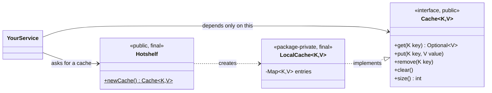
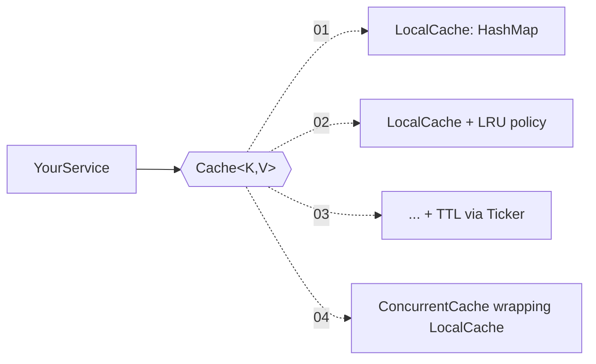
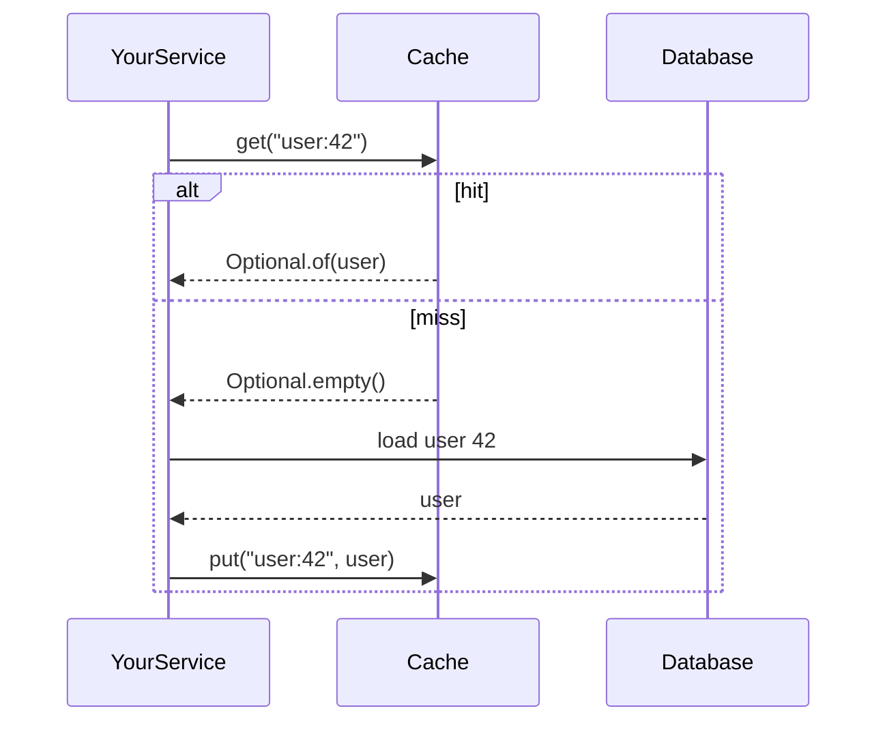

# Iteration 01: The cache contract

## Goal
Define the `Cache<K, V>` interface and a first, **unbounded, single-threaded** implementation. At this point the cache is basically
a `HashMap` with a carefully specified API. It is boring on purpose: we get the *contract* right before adding the clever parts.

## Concepts you'll learn
- **Hit** (the key is in the cache) vs **miss** (it isn't, so the caller must go to the source).
- What a cache API needs and what it should *not* expose.
- Null semantics and why `Optional` makes "absent" explicit (ADR-002).
- **Contract tests**: one abstract test suite that every implementation must pass (LSP in practice).

## Scope
**In**
```java
public interface Cache<K, V> {
    Optional<V> get(K key);
    void put(K key, V value);
    void remove(K key);      // later iterations may return the removed value; keep it simple now
    void clear();
    int size();
}
```
- `LocalCache<K, V>` (package-private) backed by a `HashMap<K, V>`.
- A temporary factory method `Hotshelf.newCache()` so tests don't depend on the package-private class name.
  The builder replaces it in iteration 02.

**Out**
- Any size limit, expiry, locking or stats.
- `get(key, loader)`. It arrives in iteration 06, when we can do it properly.

## Design

| Decision | Pattern / principle | Why |
|---|---|---|
| `Cache` is an interface; `LocalCache` is package-private | **Program to an interface**, information hiding | Users depend on the contract. We can rewrite internals freely (we will, in every iteration). |
| Only 5 methods | **ISP** | Every method is a promise we must keep through all future iterations. Fewer promises, fewer chances to break one. |
| `get` returns `Optional<V>` | Explicit absence | No "is null a miss or a cached null?" ambiguity |
| `null` key or value → `NullPointerException` via `Objects.requireNonNull` | Fail fast | The bug surfaces where it was made, not three layers later |

### Diagrams

**Who can see what.** The user only ever touches the two public types. `LocalCache` is hidden behind them.



**Why the interface pays off.** Every later iteration swaps what sits behind `Cache`, and `YourService` never changes.



**Hit vs miss, as the API expresses it.**



**Rejected:** extending `java.util.Map`. `Map` has about 25 methods (`entrySet`, `containsValue`, ...) that are hard
or meaningless to support efficiently once eviction and expiry exist, so it would be an LSP violation waiting to happen.

### Contract tests
```java
abstract class CacheContractTest {
    protected abstract Cache<String, String> newCache();

    @Test void getAfterPutReturnsValue() { ... }
    @Test void getMissingKeyIsEmpty() { ... }
    @Test void putOverwritesExistingValue() { ... }
    @Test void removeMakesKeyAbsent() { ... }
    @Test void nullKeyIsRejected() { ... }
    ...
}
class LocalCacheTest extends CacheContractTest { ... }
```
Later implementations, like the thread-safe decorator, extend the same class and inherit all the checks for free.

## Definition of done
- [ ] `Cache` interface with Javadoc stating each method's contract, including null behaviour.
- [ ] `LocalCache` passes `CacheContractTest`.
- [ ] Overwriting a key doesn't change `size()`. `remove` of a missing key is a no-op.

## Pitfalls
- Javadoc that says *how* (e.g. "uses a HashMap") instead of *what* (the contract). Implementations will change, and the contract shouldn't.

## Later
- `remove` returning `Optional<V>`, plus `putIfAbsent`. Add them only when a use case appears.

## Learning log
*(fill in after the iteration)*
